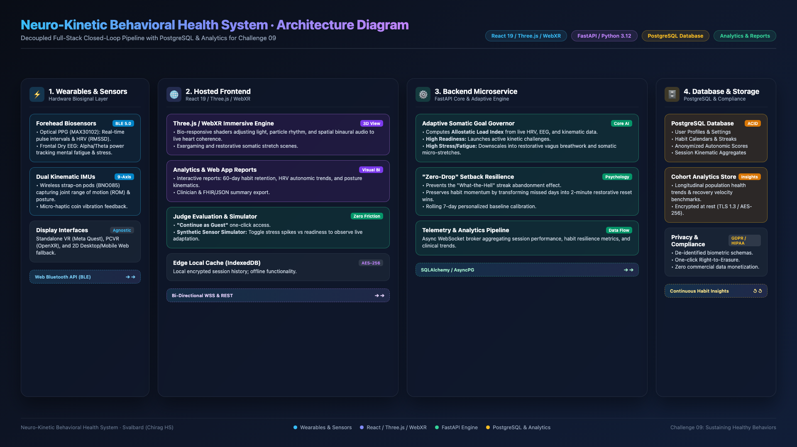
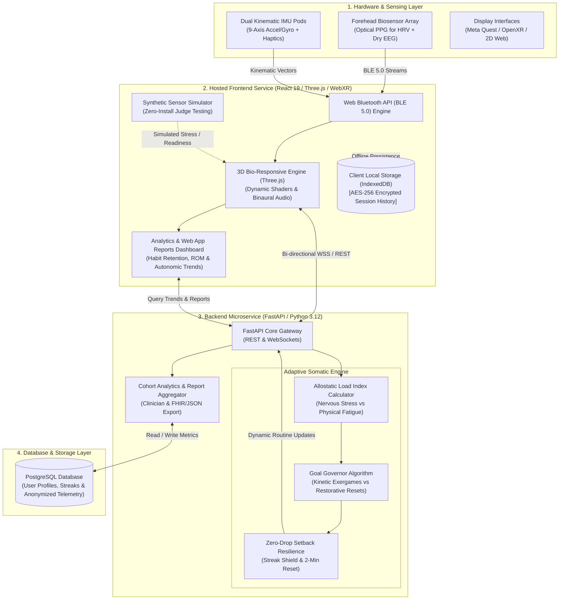

# Neuro-Kinetic Behavioral Health System (SomaSync VR)

> **Wellbeing · Challenge 09 (3.1): Sustaining Healthy Behaviors**  
> An adaptive, closed-loop mind-body digital therapeutic platform that unites biosensing wearables, kinematic motion tracking, and immersive VR to help people **start**, **keep up**, and **recover** healthier behaviors.

---

## 📌 Executive Summary

Maintaining health behaviors is rarely a failure of willpower—it is a failure of static, non-adaptive systems. When life interventions demand rigid daily adherence, normal setbacks (stress, illness, fatigue, burnout) trigger demoralization and total habit abandonment.

The **Neuro-Kinetic Behavioral Health System** bridges physiological readiness with physical capability. By fusing wearable biosensors (EEG / PPG / HRV) with kinematic limb tracking (IMUs) inside an immersive Virtual Reality environment, the system creates an intelligent somatic feedback loop:
- **Assesses Nervous System State:** Detects real-time acute stress, autonomic fatigue, or burnout.
- **Assesses Physical Kinematics:** Measures posture, movement fluidity, and joint range of motion.
- **Dynamically Adapts Behavioral Goals:** Automatically recalibrates the daily routine between active movement workouts and restorative mindfulness/parasympathetic breathing, ensuring users never drop out during life setbacks.

---

## 🔬 Core Problem & Challenge 09 Solution

| Challenge Phase | Why People Fail Today | How Neuro-Kinetic System Solves It |
| :--- | :--- | :--- |
| **1. Starting** | Overwhelming initial friction; high cognitive activation threshold to begin working out or meditating. | **Micro-Engagement Sessions (2–5 min):** Low-barrier VR onboarding where sensory immersion minimizes external distraction and immediately establishes focus. |
| **2. Keeping Up** | Lack of immediate, tangible feedback; routines become repetitive and disconnected from daily energy levels. | **Closed-Loop Bio-Responsive Experience:** The virtual world visually and sonically responds to real-time heart rate coherence, brainwave calm, and fluid movements. |
| **3. Setback Recovery** | Binary "streak breaking" triggers shame and quitting after a few missed or low-energy days. | **Adaptive Goal Governor ("Zero-Drop" Guarantee):** When low HRV or high cognitive load is detected, goals auto-scale from strenuous movement to restorative nervous-system resets. Streaks are preserved. |

---

## 🛠️ System Architecture: Hardware + Software



### Mermaid Architecture Diagram



### Architecture Highlights
* **Decoupled Frontend-Backend Model:** Hosted interactive client (`React 19 / Three.js / WebXR`) communicating via bi-directional WebSockets and REST APIs with a high-performance Python (`FastAPI`) backend.
* **Database & Persistence:** Relational **PostgreSQL** database maintaining user accounts, habit history, and longitudinal telemetry aggregates, backed by client-side **IndexedDB (AES-256)** for offline resilience.
* **Analytics & Web App Reports:** Comprehensive dashboards measuring 60-day habit retention, Setback Recovery Velocity (SRV), Heart Rate Variability (HRV) autonomic gains, and joint mobility metrics with clinician export support.
* **Zero-Install Evaluation:** Built-in "Continue as Guest" mode with an interactive **Synthetic Sensor Simulator** allowing evaluators to test bio-adaptive features without physical hardware.

### 1. Hardware Layer
* **Forehead/Headset Biosensor Array (OpenBCI-compatible / PPG):**
  * **Frontal EEG:** Measures cognitive load and relaxation indices (Alpha/Theta power bands).
  * **Optical PPG (MAX30102):** Continuously tracks Heart Rate (HR) and Heart Rate Variability (HRV / RMSSD) as an indicator of autonomic nervous system readiness.
* **Wearable Kinematic IMUs (SlimeVR / BNO085-based):**
  * Wireless 9-axis Inertial Measurement Units strapped to limbs/torso for accurate posture, mobility, and movement tracking without external optical cameras.
  * Embedded coin vibration motors for subtle haptic guidance.
* **Display / Immersion:**
  * OpenXR / SteamVR compliant VR or Mixed Reality (MR) headset, plus standard 2D web fallback.

### 2. Software & Database Layer
* **Hosted Frontend Service (`React 19 / Three.js / WebXR`):**
  * Direct browser-to-hardware communication using the **Web Bluetooth API (BLE)**.
  * Real-time 3D Somatic Biofeedback scene adjusting visual lighting, particle flows, and spatial soundscapes based on live autonomic coherence.
  * **Analytics & Web App Reports:** Interactive charts tracking habit streaks, mobility progress, and recovery indicators.
  * Interactive **Synthetic Sensor Simulator** control panel for zero-install judge evaluation.
* **Backend Microservice (`FastAPI / Python 3.12`):**
  * Asynchronous REST and WebSocket pipeline ingesting multi-modal sensor telemetry.
  * **Adaptive Somatic Engine:** Calculates real-time **Allostatic Load Index** and dynamically scales between active movement exergames and parasympathetic vagus resets.
  * **Zero-Drop Habit Governor:** Non-punitive streak shielding and baseline calibration against rolling 7-day personal history.
  * **Analytics & Reporting Pipeline:** Processes cohort-level adherence benchmarks and clinician exports.
* **Database Layer (`PostgreSQL`):**
  * ACID-compliant storage for user authentication, personalized baselines, habit logs, and anonymized physiological metrics.
  * Encrypted at rest (TLS 1.3 / AES-256) ensuring full alignment with GDPR and HIPAA standards.

---

## 🧭 Repository Structure (Planned)

```text
├── hardware/
│   ├── schematics/        # PCB designs for IMU straps and biosensor breakouts
│   ├── cad/               # 3D-printable sensor enclosures & headset clips
│   └── firmware/          # Embedded C++ firmware for ESP32/nRF52 microcontrollers
├── engine/
│   ├── sensor_fusion/     # Real-time BLE data pipeline for EEG, PPG, and IMUs
│   ├── adaptive_logic/    # Algorithm scaling daily challenges based on allostatic load
│   └── biometrics/        # HRV and EEG signal processing algorithms
├── vr_app/
│   ├── Assets/            # Immersive scenes, shaders, and audio-reactive elements
│   ├── Scripts/           # OpenXR integration and bio-interactive game mechanics
│   └── Plugins/           # Native bridge libraries for sensor streaming
├── docs/                  # System documentation, clinical rationale, and setup guides
└── README.md
```

---

## 🚀 Getting Started (Roadmap)

- [ ] **Phase 1: Sensor Ingestion Proof-of-Concept**
  - Stream BLE data from an IMU sensor pod and PPG/EEG simulator into a unified Python bridge.
- [ ] **Phase 2: Adaptive Habit Algorithm**
  - Implement the allostatic readiness scoring formula that recalculates goal intensity.
- [ ] **Phase 3: VR Prototype Integration**
  - Build an OpenXR demo scene that scales visual environment complexity and movement targets in response to biometrics.
- [ ] **Phase 4: User Testing & Setback Simulation**
  - Validate user retention and perceived stress reduction across simulated interrupted routines.

---

## 📄 License & Attribution

This project is licensed under the Apache 2.0 / MIT License. Open-source contributions and integrations draw inspiration from community standards in **OpenBCI**, **SlimeVR**, and **InfiniTime**.
